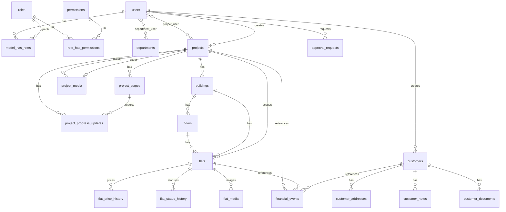

# Phase 1 ERD

Notes:

- Every table exposed to the browser has a random 16-character `public_id`; internal `id`
  values never leave the server.
- `flats.project_id` is denormalised for scoping and always derived from the floor's building.
- There is no customer–flat link in Phase 1; bookings in Phase 3 will create it.
- `activity_log.project_id` lets a project's history be listed in one indexed query.
- `settings` (key/value) holds branding.
