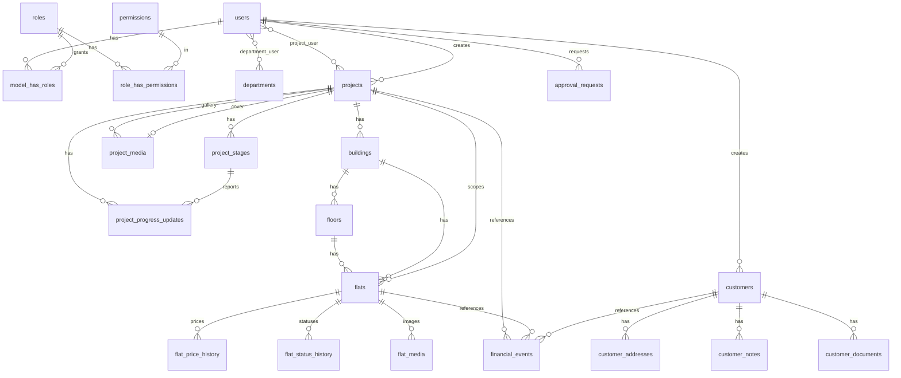

# Phase 1 ERD

Notes:

- Every table exposed to the browser has a random 16-character `public_id`; internal `id`
  values never leave the server.
- `flats.project_id` is denormalised for scoping and always derived from the floor's building.
- There is no customer–flat link in Phase 1; bookings in Phase 3 will create it.
- `activity_log.project_id` lets a project's history be listed in one indexed query.
- `settings` (key/value) holds branding.

# Phase 2 ERD

```mermaid
erDiagram
    projects ||--o{ construction_work_packages : has
    construction_work_packages ||--o{ milestones : has
    projects ||--o{ construction_progress_updates : has
    projects ||--o{ labour_entries : has

    projects ||--o{ warehouses : owns
    warehouses ||--o{ stock_balances : holds
    materials ||--o{ stock_balances : in
    warehouses ||--o{ stock_movements : ledger
    stock_receipts ||--o{ stock_movements : posts
    stock_issues ||--o{ stock_movements : posts
    material_borrows ||--o{ material_borrow_lines : has
    material_transfers ||--o{ material_transfer_lines : has

    suppliers ||--o{ purchase_orders : receives
    purchase_orders ||--o{ purchase_order_lines : has
    purchase_orders ||--o{ goods_receipts : received_by
    goods_receipts ||--o{ goods_receipt_lines : has
    goods_receipt_lines }o--o| supplier_bills : billed_in
    suppliers ||--o{ supplier_bills : owes
    suppliers ||--o{ supplier_payments : paid
    supplier_payments ||--o{ supplier_payment_allocations : allocates
    supplier_bills ||--o{ supplier_payment_allocations : settled_by
    goods_receipts ||--o{ purchase_returns : returned
    suppliers ||--o{ supplier_ledger_entries : ledger

    contractors ||--o{ contractor_work_orders : awarded
    projects ||--o{ contractor_work_orders : scopes
    contractor_work_orders ||--o{ contractor_measurements : measured
    contractor_work_orders ||--o{ contractor_bills : billed
    contractor_bills ||--o{ contractor_bill_measurements : includes
    contractor_measurements ||--o| contractor_bill_measurements : billed_once
    contractor_work_orders ||--o{ contractor_payments : paid
    contractor_bills ||--o{ contractor_payments : settles
    contractors ||--o{ contractor_ledger_entries : ledger

    expense_categories ||--o{ expense_categories : parent
    expense_categories ||--o{ expenses : classifies
    projects ||--o{ expenses : project_scope
    expenses ||--o{ expense_actions : history

    projects ||--o{ project_cost_allocations : cost
    projects ||--o{ financial_events : references
```

Notes:

- `project_cost_allocations` has one writer (`CostAttribution`): stock issues (material), labour entries,
  contractor bills and project expenses. Reversals add negative rows; nothing is deleted.
- Stock movements, ledger entries, borrow actions and expense actions are append-only.
- `attachments` (polymorphic) holds files for progress updates, suppliers, orders, bills, payments,
  contractors, work orders and expenses.
